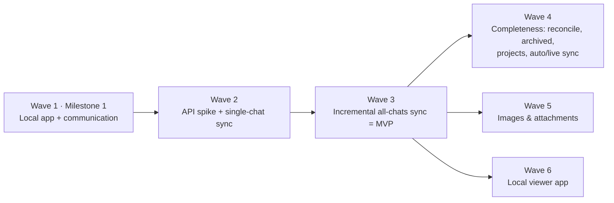

# Local Sync — Development Waves

Companion to [local-sync-feature.md](./local-sync-feature.md) (rev 2). The design decisions and review findings (R1–R11) are in that document. This file covers **what gets built, in which order, and how each step is verified**.

## How to read this plan
- A **wave** is a set of tasks that can be built **in parallel** once the waves it depends on are done. Big waves are split into sub-waves (1A → 1B → 1C).
- Every task lists the **files** it touches, its **dependencies**, and a **Done when** check that can be run, not just a description.
- **Milestone 1 = Wave 1**: everything runs locally, the local app is confirmed working, and the extension ↔ local app channel is proven. No ChatGPT data is synced yet.

## Environment (checked on this machine)
| Tool | Status | Note |
|---|---|---|
| Node.js | ✅ v24.18.0 | Runs `.ts` directly. `node:sqlite` works (SQLite 3.53.1). |
| pnpm | ⚠️ not on PATH | Use `corepack pnpm install` (or `corepack enable` from an admin shell). |
| Chrome | ✅ installed | Target browser. |
| Edge | ✅ installed | Optional extra registration. |
| .NET SDK | ❌ not installed | Only needed if the host is switched to C#. |

---

## Overview



| Wave | Outcome | Size |
|---|---|---|
| **1** | Extension ↔ local host round-trip works. The DB file is created. The popup shows a live host status. | ~2–3 days |
| **2 — in progress** | Single-chat sync and the sanitized Wave 2.1 API probe are implemented and automated checks pass. Regular-chat and one project-chat probes were reviewed; the tested project chat appeared in the sampled default list, but full coverage, ordering-parameter support, and archive behavior remain unconfirmed. Insert/no-op/update confirmation remains. See the [Wave 2.1 probe plan](./local-sync-wave-2.1-probe-plan.md) and [detailed Wave 2 plan](./local-sync-wave-2-plan.md). | ~2–3 days |
| 3 | **Sync MVP**: incremental sync of all chats with early stop, progress, and Stop. | ~3–4 days |
| 4 | Deleted, archived, and project chats; auto-sync; live sync. | ~3 days |
| 5 | Images and attachments in a content-addressed store. | ~2 days |
| 6 | Local viewer, staged: **6A browse/read**, then **6B branches/search (FTS5)**, then **6C MD/JSON export**. See the [Wave 6 plan](./local-sync-wave-6-plan.md). | Estimate after 6A implementation |

---

## Wave 1 — Milestone 1: local app + communication

**Implemented and locally verified (2026-10-20).** The native host is registered for
the current Windows user, and the production build is ready to load unpacked.
The browser check uses a disposable Chrome profile, not your existing profile or
ChatGPT login. No conversation sync is implemented yet.

### Run Wave 1 locally

From the repository root in PowerShell:

```powershell
corepack pnpm install
node .\scripts\local\gen-extension-key.mjs
corepack pnpm build
powershell -NoProfile -ExecutionPolicy Bypass -File .\local-app\scripts\register-host.ps1
node .\local-app\scripts\smoke-host.mjs
```

Open `chrome://extensions`, enable **Developer mode**, choose **Load unpacked**,
and select `.output\chrome-mv3`. The popup's primary action is **Sync this chat**;
choose **Open** to expand **Local sync**, then click **Test connection**. Expand
**Developer diagnostics** for **Echo 10 MB**. No ChatGPT tab or login is needed
for these diagnostics.
Each connection test shows a numbered pass/fail result and a **Last checked**
time. A pass means the host replied and the database opened; no chats are synced.

The registration is per-user; it needs no administrator rights. The execution
policy setting applies only to that PowerShell invocation, not to the system.
Database and logs live under `%LOCALAPPDATA%\ChatGPTBackup`. The public identity
key, launcher and expected origin are git-ignored. The key script keeps the same
identity on reruns; use `--force` only to intentionally change identity, then
rebuild, reload and register again. Re-run registration if you move this repo or
change the Node installation.

Validation commands:

```powershell
corepack pnpm compile
corepack pnpm test:local-sync
node --test .\tests\messaging-bugs.test.mjs
node .\tests\local-app\connection.browser.mjs
```

The last command needs the registered host and a current Chrome that supports the
CDP `Extensions.loadUnpacked` method. It uses extension-debugging flags only in
its isolated, temporary profile, checks the real popup and 10 MB transfer, checks
error rendering with injected replies, waits for the host to stop, and cleans up
its browser profile. Set `CHROMIUM_PATH` to override the default Chrome executable.
The normal extension does not need those debugging flags.

To unregister (preserving all database files and logs):

```powershell
powershell -NoProfile -ExecutionPolicy Bypass -File .\local-app\scripts\unregister-host.ps1
```

There is intentionally **no `-PurgeData` option**; the script never deletes
conversation data. Pass `-Browser Edge` or `-Browser Both` to either registration
script if needed. Default is Chrome only.

**Goal:** prove the full local chain before writing any sync logic:

```
Popup ──runtime msg──▶ Background ──connectNative──▶ run-host.cmd ──▶ node main.ts ──▶ sync.db
  ▲                                                                       │
  └──────────── status / pong / echo hash ◀──────── stdio framing ◀────────┘
```

### Target layout after Wave 1
```
.local/                          (git-ignored) extension-key.pub.txt, extension-id.txt
lib/sync/protocol.ts             shared types/constants (extension + host)
lib/sync/host-client.ts          extension-side Native Messaging client
local-app/
  host/
    main.ts                      entry: origin check, log redirect, dispatch loop
    framing.ts                   4-byte LE length-prefix reader/writer
    handlers.ts                  ping, echo, hello, getStatus
    db.ts                        open DB (WAL) + migrations
    log.ts                       console → %LOCALAPPDATA%\ChatGPTBackup\logs\host.log
    run-host.cmd                 generated by register-host.ps1 (absolute node.exe path)
  scripts/
    register-host.ps1
    unregister-host.ps1
    smoke-host.mjs               talks to the *registered* host the same way Chrome does
scripts/local/gen-extension-key.mjs
tests/local-app/host.test.mjs
```

### Wave 1A — foundations (all three in parallel)

#### W1.1 Pin the extension ID
- **Files:** `scripts/local/gen-extension-key.mjs`, `wxt.config.ts`, `.gitignore`
- **Depends on:** —
- **Work:**
  - The script generates an RSA-2048 key pair with `node:crypto` and writes the base64 SPKI-DER public key to `.local/extension-key.pub.txt`. It computes the ID (sha256 of the DER, first 32 hex chars mapped `0-9a-f → a-p`) and writes it to `.local/extension-id.txt`. If the key already exists, it does nothing unless `--force` is passed.
  - `wxt.config.ts`: if `.local/extension-key.pub.txt` exists, set `manifest.key`. Always add `nativeMessaging` to `permissions`.
  - Add `.local/` to `.gitignore`.
- **Done when:** after `corepack pnpm build`, loading `.output/chrome-mv3` unpacked shows **the same ID** as `.local/extension-id.txt` in `chrome://extensions`. Copying `.output/chrome-mv3` to another folder and loading it again gives the same ID.
- **Note:** load only one of `.output/chrome-mv3` and `.output/chrome-mv3-dev` at a time, because they now share an ID.

#### W1.2 Protocol contract
- **Files:** `lib/sync/protocol.ts`
- **Depends on:** —
- **Work:** `HOST_NAME = 'com.chatgpt_backup.sync'`, `PROTOCOL_VERSION = 1`, `MAX_HOST_TO_EXT_BYTES = 1_000_000`, `MAX_EXT_TO_HOST_BYTES = 64 * 1024 * 1024`. Envelope `{ v, id, type, payload }`, request and response types for `ping`, `echo`, `hello`, `getStatus`, and the `ErrorCode` union. Use **erasable syntax only**: no `enum`/`namespace`; use `as const` objects and union types, so Node can import the file directly.
- **Done when:** `corepack pnpm compile` passes, and `node -e "import('./lib/sync/protocol.ts').then(m=>console.log(m.HOST_NAME))"` prints the host name.

#### W1.3 Host skeleton: framing, logging, dispatch
- **Files:** `local-app/host/main.ts`, `framing.ts`, `handlers.ts`, `log.ts`
- **Depends on:** — (uses W1.2 types; can be written against the agreed contract)
- **Work:**
  - `log.ts`: at startup, replace `console.log/info/warn/error/debug` with a file logger. **Nothing except framed messages may go to stdout.**
  - `framing.ts`: a reader that collects stdin chunks and handles split headers and several messages in one chunk. It rejects frames over 64 MiB, and the writer refuses frames over 1 MB with an error.
  - `main.ts`: reads the caller origin from `process.argv` (Chrome passes `chrome-extension://<id>/` and, on Windows, `--parent-window=<n>`). It compares the origin with the expected ID (from `CHATGPT_SYNC_ALLOWED_ORIGIN` or a sibling `allowed-origin.txt` written at registration) and answers `FORBIDDEN_ORIGIN` before exiting if it does not match. It dispatches messages to handlers and exits cleanly when stdin closes.
  - Handlers: `ping` → `{hostVersion, protocolVersion, pid, uptimeMs}`. `echo` → `{bytes, sha256}` (it never echoes the data back, to stay under 1 MB). Unknown types → `UNKNOWN_TYPE`. Bad JSON → `INVALID_PAYLOAD`. The host keeps running after a bad message.
- **Done when:** the W1.6 framing and handler tests pass.

### Wave 1B — host completion, registration, extension client (parallel)

#### W1.4 Host DB bootstrap
- **Files:** `local-app/host/db.ts`, `handlers.ts`
- **Depends on:** W1.2, W1.3
- **Work:** data dir = `CHATGPT_SYNC_DATA_DIR` or `%LOCALAPPDATA%\ChatGPTBackup`. Open `sync.db` with `node:sqlite`, set `PRAGMA journal_mode=WAL`, `busy_timeout=5000`, and `foreign_keys=ON`. Add a `schema_migrations` table and **migration 1**: a `meta` key/value table with `created_at`, `host_version`, and `install_id`. Real sync tables come in Wave 2. `hello` → `{hostVersion, protocolRange:[1,1], capabilities:['ping','echo','status'], dbPath, schemaVersion, counts:{conversations:0}}`. `getStatus` → the same fields without negotiation. Open the DB lazily on the first `hello`/`getStatus`, so `ping` works even if the DB is broken.
- **Done when:** after one `hello`, `sync.db` exists in the data dir, `schema_migrations` has version 1, and a second start does not run migration 1 again.

#### W1.5 Registration scripts
- **Files:** `local-app/scripts/register-host.ps1`, `unregister-host.ps1`
- **Depends on:** W1.1 (ID), W1.3 (entry point)
- **Work (`register-host.ps1 [-ExtensionId <id>] [-Browser Chrome|Edge|Both]`):**
  1. Resolve the ID from the parameter or `.local\extension-id.txt`, and check it against `^[a-p]{32}$`.
  2. Find `node.exe` and require major version ≥ 24.
  3. Generate `local-app\host\run-host.cmd` with the **absolute node path**, because Chrome may start it with a different PATH: `@echo off` + `"C:\...\node.exe" --disable-warning=ExperimentalWarning "%~dp0main.ts" %*`.
  4. Write the manifest to `%LOCALAPPDATA%\ChatGPTBackup\host\com.chatgpt_backup.sync.json` with `name`, `description`, `path` (absolute `run-host.cmd`), `type: "stdio"`, and `allowed_origins: ["chrome-extension://<id>/"]`. Write `allowed-origin.txt` next to `main.ts` for the host's own check.
  5. Set the default value of `HKCU\Software\Google\Chrome\NativeMessagingHosts\com.chatgpt_backup.sync` to the manifest path. With `-Browser Edge|Both`, also set `HKCU\Software\Microsoft\Edge\NativeMessagingHosts\…`.
  6. Print a summary: ID, manifest path, launcher path, node version.
  - `unregister-host.ps1` removes the selected keys and the generated manifest when no supported browser registration remains. It always keeps `sync.db`, logs and the identity files.
- **Done when:** `reg query "HKCU\Software\Google\Chrome\NativeMessagingHosts\com.chatgpt_backup.sync"` shows the manifest path, the manifest parses as JSON, and running the script twice gives the same result.

#### W1.6 Host tests + smoke tool
- **Files:** `tests/local-app/host.test.mjs`, `local-app/scripts/smoke-host.mjs`
- **Depends on:** W1.3 (W1.4 for the `hello` cases, W1.5 for the smoke tool)
- **Work:**
  - `node:test` suite that starts `node local-app/host/main.ts chrome-extension://<testid>/` with a temp `CHATGPT_SYNC_DATA_DIR`. Cases:
    - `ping`
    - `echo` with 10 MB (sha256 matches)
    - two messages in one write
    - a header split across writes
    - unknown type
    - invalid JSON (the host keeps running)
    - wrong origin (`FORBIDDEN_ORIGIN`)
    - `hello` creates the DB
    - **stdout cleanliness**: every byte on stdout belongs to a valid frame
  - `smoke-host.mjs`: reads the registry → manifest → `path`, and starts the **registered launcher** the way Chrome does (with the origin argument). It sends `ping` and `hello` and prints the results. This proves registration works without Chrome.
- **Done when:** `node --test tests/local-app/` passes. After registering, `node local-app/scripts/smoke-host.mjs` prints the pong and the DB path.

#### W1.7 Extension host client + background handlers
- **Files:** `lib/sync/host-client.ts`, `entrypoints/background.ts`
- **Depends on:** W1.2
- **Work:**
  - `HostClient`: lazy `chrome.runtime.connectNative(HOST_NAME)`, request/response matching by `id`, a per-request timeout (default 10 s), rejection of all pending requests on `onDisconnect` with the `chrome.runtime.lastError.message` mapped to `not-registered | forbidden | host-exited | unknown` (see the feature doc §7 error table), and an **idle disconnect after 30 s** so the host and service worker can stop.
  - Background messages (runtime, popup → background only):
    - `syncHostStatus` → connect, `hello`, `ping`, then `{state:'connected'|…, hostVersion, protocolVersion, dbPath, schemaVersion, rttMs, error?}`
    - `syncHostEcho {sizeMB}` (diagnostic) → builds a payload, computes sha256 in the extension, and compares it with the host's hash
  - Only the background opens the port (R3).
- **Done when:** `corepack pnpm compile` passes. W1.9 checks the behavior.

### Wave 1C — UI and milestone check

#### W1.8 Popup "Local sync" status panel
- **Files:** `entrypoints/popup/App.tsx` (and `components/ui/*` if needed)
- **Depends on:** W1.7
- **Work:** a small collapsible "Local sync" card:
  - a state indicator (✅ Connected / ❌ App not registered / ⚠️ ID mismatch / ⚠️ Host error)
  - host version, protocol version, DB path (copy button), round-trip time
  - a **Test connection** button that calls `syncHostStatus` again
  - in a developer-only area, an **Echo 10 MB** button
  - each error state shows the fix: the `register-host.ps1` command, or the `host.log` path
  - the popup presents **Sync this chat** as its primary action and **Open**
    expands the local-sync details
- **Done when:** every state can be shown with the negative steps in W1.9.

#### W1.9 Milestone 1 end-to-end check (manual checklist)
- **Depends on:** W1.1–W1.8
- **Steps:**
  1. `corepack pnpm install` → `node scripts/local/gen-extension-key.mjs` → `corepack pnpm build`.
  2. Load `.output/chrome-mv3` unpacked and confirm the ID equals `.local/extension-id.txt`.
  3. `powershell -ExecutionPolicy Bypass -File local-app\scripts\register-host.ps1`.
  4. `node local-app\scripts\smoke-host.mjs` → pong + DB path.
  5. Open the popup → **Local sync: ✅ Connected**, host v0.1.0, protocol 1, DB path, RTT shown.
  6. Click **Echo 10 MB** → hashes match.
  7. Check that `%LOCALAPPDATA%\ChatGPTBackup\sync.db` and `logs\host.log` exist.
  8. Close the popup and wait about 30 s. Confirm `Host stopped <pid>` follows `Host started <pid>` in `host.log`; do not stop unrelated Node processes.
  9. **Negative tests:**
     - `unregister-host.ps1` → popup shows "App not registered".
     - Register with a wrong `-ExtensionId` → "ID mismatch".
     - A `console.log` after logging setup goes to `host.log`, not stdout (covered by tests). To simulate a host error, temporarily rename `main.ts`, click **Test connection**, then restore it.
  10. Regression: the popup presents **Sync this chat** as the primary action and **Open** reveals the collapsed local-sync section.

### Milestone 1 — Definition of Done
- [x] Native-host/client tests, TypeScript checking and production build pass.
- [x] Extension ID is pinned and matches the registration and real Chrome load.
- [x] Registered host answers `ping`/`hello` from both `smoke-host.mjs` and the real popup.
- [x] `sync.db` is created with schema version 1. Restarting does not re-run the migration.
- [x] A 10 MB extension → host payload is checked by hash. Host reply limit is enforced by framing tests.
- [x] Popup error rendering/recovery instructions are checked; launch-error mapping and wrong-origin rejection have dedicated tests.
- [x] The host process exits after the idle timeout. Stdout cleanliness is tested.
- [x] The popup's Sync action is visible while local-sync diagnostics stay
  collapsed until **Open** is selected; the former download/export entrypoints
  and permission are absent.

### Verification snapshot (2026-10-20)

- `corepack pnpm compile` — passed.
- `corepack pnpm test:local-sync` — 16 tests passed.
- `corepack pnpm build` — passed.
- Historical, before export removal: `node --test .\tests\messaging-bugs.test.mjs .\tests\pdf-export.test.mjs` — 7 tests passed.
- `node .\tests\local-app\connection.browser.mjs` — passed against a disposable Chrome profile: popup connection, 10 MB echo, error states, and idle shutdown.
- `%LOCALAPPDATA%\ChatGPTBackup\sync.db` — SQLite integrity check passed; WAL mode; schema version 1. Only `meta` and `schema_migrations` application tables exist, as expected before Wave 2; no conversation sync has run.
- The earlier log had a host start without a matching stop and that PID was no longer running. Re-running the browser integration completed with a matching start/stop pair, so the earlier attempt was incomplete rather than a persistent host hang.

The automated browser check intentionally does not access a signed-in ChatGPT profile.

---

## Wave 2 — API spike + single-chat sync

**Status:** Single-chat and sanitized API-probe implementations and automated checks are complete. Signed-in regular-chat and one project-chat reports have been reviewed; the tested project conversation appeared in the sampled default list, but full project coverage, ordering-parameter support, and archive behavior remain unconfirmed. The DB shows one completed insert followed by three completed update outcomes, with no failures. Repeated same-chat payload diffs changed only `safe_urls[]`; this is now classified as metadata-only, refreshing the raw snapshot while leaving message rows unchanged. The popup now makes Sync the primary action and Open expands local-sync details. Download/export UI and handlers have been removed. Live confirmation of metadata-only followed by a byte-identical no-op remains pending. See the [Wave 2.1 sanitized API probe plan](./local-sync-wave-2.1-probe-plan.md) and [detailed Wave 2 implementation plan](./local-sync-wave-2-plan.md) for task sequence, boundaries, and acceptance checks.

**Goal:** the first real data reaches the DB. Each sync of the current chat inserts, updates, or does nothing, as appropriate.

| ID | Task | Files | Depends | Done when |
|---|---|---|---|---|
| W2.1 | **API spike**: inspect list/update ordering, archive/project fields, and `/api/auth/session` identity fields. Signed-in regular-chat and project-chat reports have been reviewed; order/archive behavior and project-list completeness remain unresolved. | `lib/chatgpt-client.ts`, `docs/local-sync-api-findings.md` | W1 | Findings doc records verified shapes or clearly leaves them unresolved; no session values or conversation content are stored. |
| W2.2 | Extract the ChatGPT client and storage parser from `defineBackground` into reusable modules; keep parsing free of `chrome.*`. | `lib/chatgpt-client.ts`, `lib/chatgpt-parse.ts`, `entrypoints/background.ts` | W1 | Compile, local-sync and regression tests pass. |
| W2.3 | Migration 2: `accounts`, `conversations`, `messages`, `sync_runs`, `sync_failures`. | `local-app/host/db.ts` | W1.4 | v1 → v2 migration is transactional and tested; existing install metadata is preserved. |
| W2.4 | Host `beginRun`, `upsertConversation` (SHA-256 → `noop` if unchanged; safe-URL-only changes refresh raw metadata without rewriting messages; other changes transactionally upsert conversation/messages), and `endRun`. | `lib/sync/protocol.ts`, `local-app/host/*` | W2.2, W2.3 | Tests cover insert → noop → update, metadata-only refresh, account scoping, all branches, active-branch flags, hash rejection, rollback, and interrupted-run cleanup. |
| W2.5 | Background sync for the active conversation and **Sync this chat** popup action. | `entrypoints/background.ts`, `lib/sync/*`, `entrypoints/popup/LocalSyncPanel.tsx` | W2.4 | Code and automated outcome/error tests pass; signed-in insert/update outcomes are observed; metadata-only followed by unchanged/no-op remains unverified. |
| W2.6 | Read-only DB CLI (`counts`, `list`, `runs`, `show <id>`). | `local-app/scripts/db-query.mjs` | W2.3 | Tests prove output shape and that counts/list/runs omit conversation contents and identifiers. |

### Wave 2 implementation verification (2026-10-20)

- `corepack pnpm compile` — passed.
- `corepack pnpm test:local-sync` — 44 tests passed.
- Historical, before export removal: `node --test .\tests\messaging-bugs.test.mjs .\tests\pdf-export.test.mjs` — 10 tests passed.
- `corepack pnpm build` — passed.
- `node .\tests\local-app\connection.browser.mjs` — passed in disposable Chrome; host v0.2.1, schema 2, popup probe button and pending/success feedback verified with an injected reply, 10 MB echo and idle shutdown verified.
- The disposable profile is not signed in to ChatGPT; this integration check did not run the live API probe or produce a user-profile `API_PROBE` report.
- `%LOCALAPPDATA%\ChatGPTBackup\sync.db` — integrity check passed, WAL mode, schema 2. Counts are zero accounts/conversations/messages/runs/failures; the integration check did not sync any ChatGPT data.
- Separate read-only inspection of the signed-in profile DB found completed
  single-chat runs with one `new=1`, followed by three `updated=1` outcomes,
  and no failures. The latest same-chat resync differed only in `safe_urls[]`.
  Metadata-only refresh now increments `updated` because the raw snapshot
  changes, while skipping message-row rewrites. No chat identifiers or
  contents are retained.
- [API findings](./local-sync-api-findings.md) explicitly separate static observations from unknown live identity/list behavior. The single-chat action refuses to sync when it cannot determine both user and workspace IDs.

**Exit:** implementation and automated checks are complete. The live signed-in
acceptance remains pending. Wave 3 implementation proceeded at the user's
request, but Wave 2 cannot be declared closed and live Wave 3 acceptance cannot
be signed off until the check is complete.

---

## Wave 3 — Incremental all-chats sync (Sync MVP)

The detailed, gated implementation sequence is in the
[Wave 3 plan](./local-sync-wave-3-plan.md). The popup UI reload is confirmed;
the Wave 2 signed-in metadata-only → byte-identical no-op check is still
pending. Wave 3 implementation proceeded at the user's request; this live
check remains required before Wave 2 or Wave 3 can be signed off.

**Implementation status:** the host manifest support/schema v3, full-list
paging, update-time no-op engine, two-second serialized ChatGPT request pacing,
default latest-10 validation scope, and new-chat/new-message reporting are
implemented. Compile, all 64 local-sync tests, all 6 messaging tests,
production build, and the Chrome/native-host popup smoke test pass. Signed-in
all-chat initial/repeat acceptance remains pending.

| ID | Task | Files | Depends | Status | Done when |
|---|---|---|---|---|---|
| W3.0 | Track the Wave 2 live gate and encode the agreed list-item `update_time` no-op rule; keep early-stop separately gated on ordering evidence. | API findings, Wave 2 plan, probe if needed | W2 | [x] Complete | The live gate status is recorded; matching list tokens skip detail fetches, while early-stop remains disabled unless ordering is verified. |
| W3.1 | Add account-scoped host manifest comparison, incremental run mode, and separate storage for the list update token. Extend and test the existing account-level writer lock. | `lib/sync/protocol.ts`, `local-app/host/*` | W3.0 | [x] Complete | Migration preserves v2 data; manifest categories, retry-after-failure, account scoping, and cross-mode locking pass tests. |
| W3.2 | Add validated full-list paging and duplicate/total-drift handling. The initial implementation processes every page; early-stop is a later optimization gated on ordering evidence. | `lib/chatgpt-client.ts`, `lib/sync/*` | W3.1 | [x] Complete | Client tests cover malformed, empty, duplicate, overlapping, and changing pages. |
| W3.3 | Add the incremental run engine using matching list-item `update_time` values to skip unchanged detail requests; fetch details when tokens are missing or malformed. | `lib/sync/*`, `entrypoints/background.ts` | W3.2 | [x] Complete | Fake API/host tests cover initial and unchanged runs, changes, errors, cancellation, and restart. |
| W3.4 | Add latest-10 validation as the default popup scope, an **All chats** option, **Stop**, progress, and new-chat/new-message counts; retain current-chat sync and diagnostics under **Open**. | `entrypoints/popup/*`, background, browser tests | W3.3 | [x] Complete | Browser tests cover scope selection, progress, stop, completion, and errors; no Options page or export UI is restored. |
| W3.5 | Run integrated validation and signed-in acceptance; document remaining API limitations. | tests, build, roadmap | W3.4 | Automated validation complete; signed-in acceptance pending | Automated checks pass; failed runs surface a sanitized cause and write aggregate failure categories to `host.log`; real-account initial and repeat sync outcomes still need sanitized review. |

**Exit:** Wave 3 acceptance in the [detailed plan](./local-sync-wave-3-plan.md)
passes. The accepted list-token no-op rule is distinct from the separately
gated early-stop paging optimization.

---

## Wave 4 — Completeness

| ID | Task | Depends |
|---|---|---|
| W4.1 | Full reconciliation: `markMissing`, `remote_state`, a weekly automatic full run, and an optional "remove local copies of deleted chats" setting (default off). | W3 |
| W4.2 | Archived chats, using the parameter confirmed in W2.1. | W3 |
| W4.3 | Project chats, using the existing project enumeration or a confirmed endpoint. | W3 |
| W4.4 | Auto-sync with `chrome.alarms` (add the `alarms` permission). It runs only when a ChatGPT session is available and no run is active. | W3 |
| W4.5 | Live sync: the content script reports a finished reply or navigation, and the background runs `syncSingle`. | W2.5 |
| W4.6 | Account-mismatch handling and a profile chooser in the popup. Optional Edge registration (`-Browser Both`). | W3 |

## Wave 5 — Assets
| ID | Task | Depends |
|---|---|---|
| W5.1 | Protocol: `hasAssets`, `assetChunk` (≤ 4 MB base64), and `assetCommit` (sha256 check). | W3 |
| W5.2 | Host content-addressed store `assets/<aa>/<sha256>` plus a `conversation_assets` table. | W5.1 |
| W5.3 | Engine: collect references with `findAssetReferences`/`findAttachmentReferences`, download with `downloadFileBlob`, and apply per-asset and per-run size limits. Options toggles. | W5.1 |

## Wave 6 — Local viewer app

The [detailed Wave 6 plan](./local-sync-wave-6-plan.md) is approved in scope:
a separate localhost browser app, with **browse/read first** and
branch navigation, search, and export delivered as later milestones.
Wave 6A is implemented: read-only archive reader, authenticated loopback server,
standalone React UI, synthetic API tests, and an isolated real-Chrome check.
A real-archive API smoke test opened all 10 chats and read 559 active messages
out of 566 stored rows with no branch warnings. Final user visual acceptance
is pending; Wave 6B/6C remain planned.

Read-only inspection on 2026-10-20 confirmed schema 3 with **10 conversations
and 566 stored message rows**; the latest incremental run completed with no
failures. This is enough to begin the viewer; it does not establish full remote
coverage or close every Wave 2/3 acceptance gate.

| ID | Task | Depends |
|---|---|---|
| W6.1 / 6A | `local-app/viewer`: Node HTTP server bound to `127.0.0.1` on an OS-selected port, per-process token, separate **read-only** SQLite connection; no viewer migrations or sync-run maintenance. | Existing W3 schema/data |
| W6.2a / 6A | Account-scoped paginated list and active-branch transcript in tree order; explicit loading/error/empty states and Refresh. | W6.1 |
| W6.2b / 6B | Alternate-branch navigation and FTS5 search. The native host owns index migration/backfill/maintenance; the viewer remains read-only. | 6A acceptance |
| W6.3 / 6C | Explicit DB-to-MD/JSON downloads, reusing compatible parts of `lib/export-document.ts`; branch scope is labeled. | 6B acceptance |
| W6.4 | *(Optional later)* A read-only MCP server/API for other tools; not required for browse/read. | W6.1 and explicit follow-up scope |

**First exit gate:** open the currently stored chats without ChatGPT access,
preserve account/branch correctness, and leave archive rows/schema/run state
unchanged. See the detailed plan for fixtures, validation, and later milestones.

---

## Risk register

| Risk | Impact | Mitigation | Wave |
|---|---|---|---|
| The unpacked extension ID changes, so the host is refused | Milestone blocked | Manifest `key` (W1.1). The popup shows "ID mismatch" with the fix. | 1 |
| Stdout pollution corrupts the channel | Host appears dead | Log redirect, stdout-cleanliness test, launcher with warnings off | 1 |
| Chrome cannot find `node` | "Host exited" right away | Absolute node path written into `run-host.cmd` at registration | 1 |
| ChatGPT's unofficial API changes | Sync breaks | One adapter module. Raw JSON is always stored. Spike in W2.1. | 2+ |
| Early stop misses changes | Silent gaps | 2-page rule plus periodic full reconciliation | 3–4 |
| Rate limiting on large accounts | Slow runs | All ChatGPT requests are serialized with a two-second quiet interval and existing retry backoff. A later run rescans from offset zero; committed chats are retained. | 3 |
| `node:sqlite` API changes in a future Node | Host breaks after a Node upgrade | Register with the known node path; keep DB access in `db.ts` so `better-sqlite3` can replace it | 1+ |
